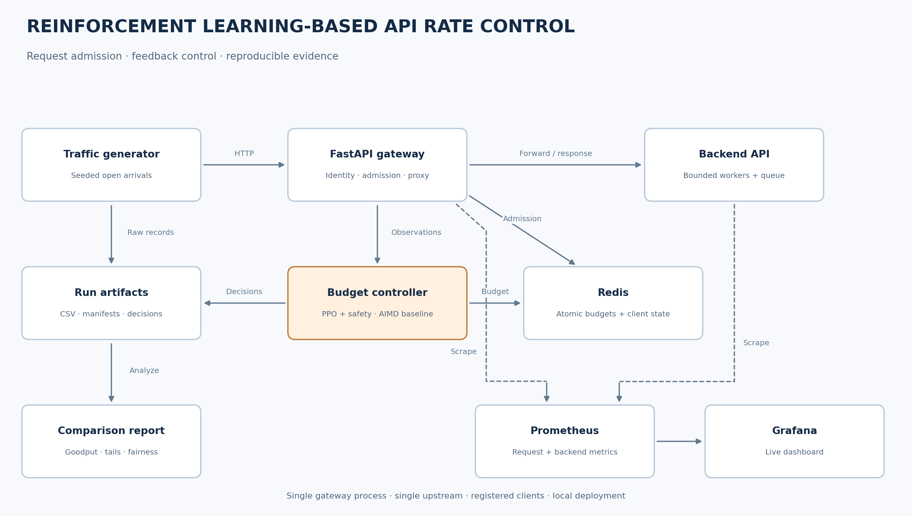
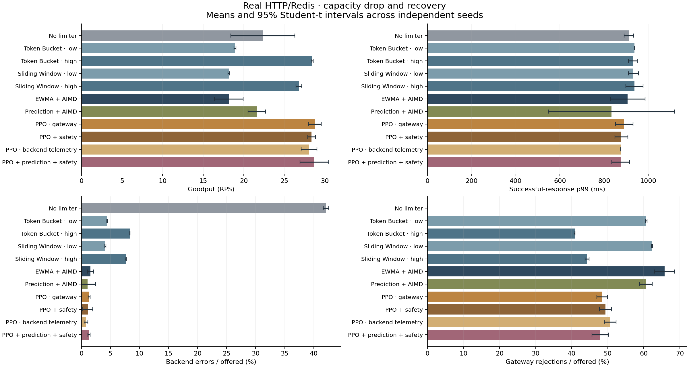
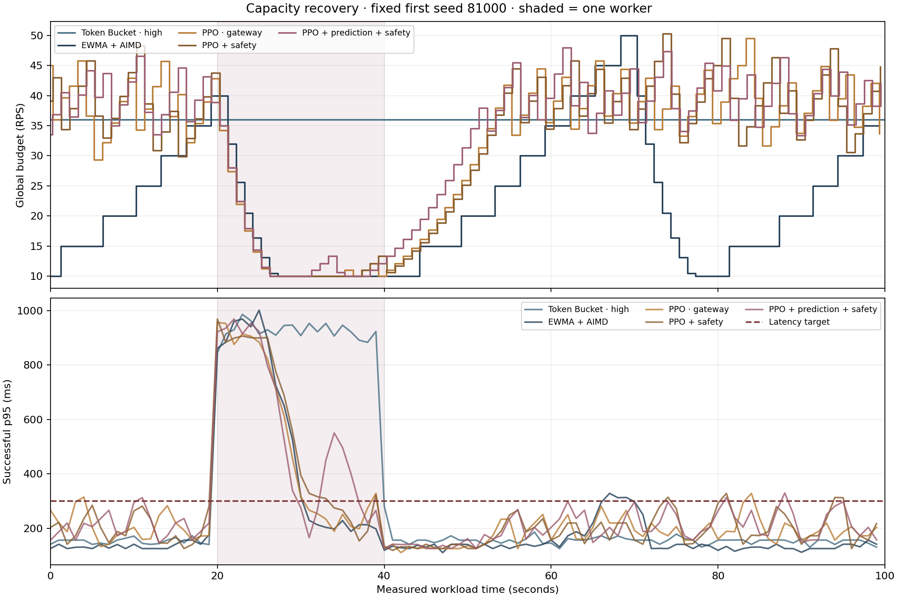
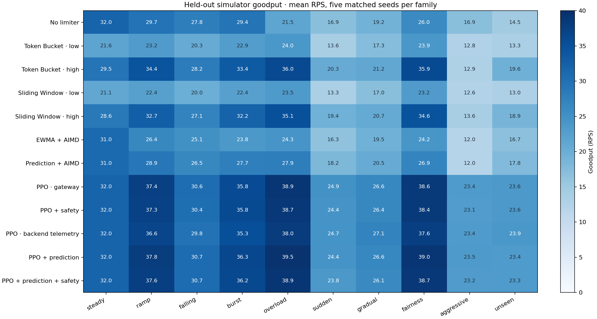
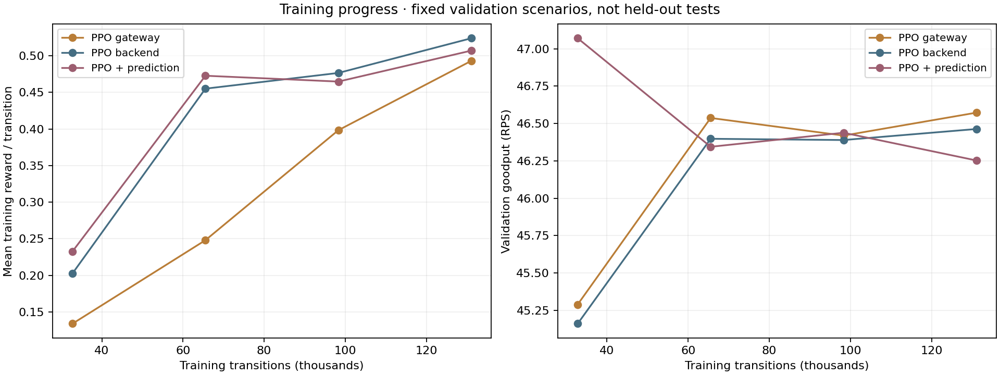

# Reinforcement Learning-Based API Rate Control

A working HTTP gateway with conventional feedback and trained reinforcement-learning controllers. Includes atomic Redis limiters, a request-level training simulator, PPO training and deployment, a bounded HTTP backend, open-arrival experiments, and a live Grafana dashboard.

**Question:** can a trained controller improve successful throughput within a latency target when backend capacity changes, compared with calibrated static budgets and EWMA/AIMD?

The original non-ML controller remains the default and a preserved baseline. The optional ML upgrade uses actual Stable-Baselines3 PPO checkpoints, deterministic NumPy actor inference once per control interval, explicit safety constraints, and an optional calibrated overload predictor. Adaptation is evaluated rather than presumed to win.

See [ML implementation, training, and deployment](docs/rl.md) and [measured comparisons and limitations](results/rl-upgrade/REPORT.md). Small trained deployment exports are included in `assets/models/`; large checkpoints and raw runs are Git-ignored and supplied as release downloads.



## Versions and downloads

- **[`main`](https://github.com/xMN-28/Reinforcement-Learning-Based-API-Rate-Control/tree/main):** the ML upgrade, trained deployment exports, and all comparisons below.
- **[`codex/legacy-ewma-aimd`](https://github.com/xMN-28/Reinforcement-Learning-Based-API-Rate-Control/tree/codex/legacy-ewma-aimd):** the original non-ML implementation preserved at commit `6c59110`, including its original commands and results.
- **[v0.2.0 release](https://github.com/xMN-28/Reinforcement-Learning-Based-API-Rate-Control/releases/tag/v0.2.0):** resumable trained checkpoints and raw benchmark evidence. Large artifacts stay out of Git; compact inference exports are in `assets/models/`.

The current Python module and CLI are `rlrc`, configuration variables use `RLRC_`, and the distribution is `reinforcement-learning-based-api-rate-control`. The legacy branch retains its original interfaces.

For an existing Windows checkout whose old folder is locked by an editor, close
Codex and terminals, then run `scripts/rename-workspace.ps1` from a PowerShell
session in the parent directory. It renames the old workspace folder and recreates
virtual-environment entry points. Fresh clones already use the new repository name.

## Results: all controller comparisons

The main **real HTTP/Redis** study completed 33 trials: eleven configurations × three matched seeds, randomized within each repetition. Every trial used 30s warm-up and 100s measurement, 60 offered RPS, a 300ms latency target, and a backend capacity change of 4→1→4 workers. Static rates (24/36 RPS) came from an independent calibration. All 198,000 measured arrivals launched; there were no model fallbacks or unknown-admission failures.

**Goodput** means successful requests completed within the end-user latency target per measured second. Fast 429 responses are excluded from successful-response latency. Intervals describe run-to-run uncertainty for fixed trained models, not retraining uncertainty.

| Controller | Goodput RPS ± 95% t interval | Success RPS | Success p95 / p99 ms | Backend errors / offered | Rejected / offered |
|---|---:|---:|---:|---:|---:|
| No limiter | 22.35 ± 3.95 | 34.74 | 848.9 / 912.0 | 42.10% | 0.00% |
| Token Bucket · low | 18.91 ± 0.13 | 20.94 | 885.3 / 937.4 | 4.42% | 60.67% |
| Token Bucket · high | 28.44 ± 0.11 | 30.49 | 854.0 / 930.0 | 8.36% | 40.82% |
| Sliding Window · low | 18.15 ± 0.09 | 20.18 | 885.3 / 932.7 | 4.12% | 62.26% |
| Sliding Window · high | 26.79 ± 0.36 | 28.85 | 864.9 / 937.3 | 7.63% | 44.29% |
| EWMA + AIMD | 18.16 ± 1.77 | 19.59 | 381.5 / 906.7 | 1.56% | 65.79% |
| Prediction + AIMD | 21.60 ± 1.09 | 23.03 | 323.1 / 833.3 | 1.04% | 60.58% |
| PPO · gateway | 28.75 ± 0.80 | 30.12 | 291.7 / 891.0 | 1.34% | 48.46% |
| PPO + safety | 28.35 ± 0.47 | 29.72 | 292.0 / 878.0 | 1.09% | 49.37% |
| PPO · backend telemetry | 28.05 ± 0.97 | 29.10 | 254.3 / 875.0 | 0.80% | 50.70% |
| PPO + prediction + safety | 28.70 ± 1.76 | 30.44 | 323.8 / 875.0 | 1.29% | 47.97% |



PPO + safety improved goodput over original AIMD by **10.19 ± 1.34 RPS** (paired 95% t interval). Its difference from the higher static Token Bucket was **−0.08 ± 0.49 RPS**, which is inconclusive. The observed backend error rate was **1.09% versus 8.36%** for that static budget. PPO therefore showed a useful throughput/error tradeoff here, rather than a demonstrated throughput win over every static policy.

**Negative results:** PPO + safety changed budgets more often: mean absolute log budget change 0.118 versus 0.071 for original AIMD. Preserved relative recovery averaged 36.7s versus 23.3s. Recovery uses 80% of each controller’s own pre-degradation goodput, so the absolute thresholds differ. Both results are retained; RL did not improve every objective. Tail latency still exceeded the target during degradation.

### Stronger conventional baseline: separate supplemental study

A 16-setting AIMD search used only validation scenarios, selecting a 2s window, EWMA α=0.5, one healthy evaluation, +5 RPS recovery steps and ten observations. The original baseline was preserved. Three later HTTP trials averaged **25.28 ± 0.93 goodput RPS**, closing much of the gap to PPO. These later runs were not interleaved with the main study, so host/time ordering is a possible confound. They retained 28 missed launches (0.47% in one trial, below the preset 1% limit) and one client transport failure with unknown admission; neither earns goodput.

<details><summary>Recovery, fairness, stability, and inference overhead</summary>

Values are means of per-run statistics. Recovery is conditional on recovery being observed; censored counts are shown. CPU/RSS describe the whole gateway process, not isolated model cost.

| Controller | Relative recovery s (n/3) | Jain fairness | SLO-violating seconds | Log budget change | Inference p95 ms | Gateway RSS p95 MB |
|---|---:|---:|---:|---:|---:|---:|
| No limiter | Not observed (0/3) | 0.99878 | 99.0 | 0.000 | — | — |
| Token Bucket · low | 15.0 (3/3) | 0.99991 | 20.7 | 0.000 | — | — |
| Token Bucket · high | 15.0 (3/3) | 0.99995 | 20.0 | 0.000 | — | — |
| Sliding Window · low | 15.0 (3/3) | 0.99992 | 20.3 | 0.000 | — | — |
| Sliding Window · high | 15.0 (3/3) | 0.99997 | 20.7 | 0.000 | — | — |
| EWMA + AIMD | 23.3 (3/3) | 0.99996 | 15.0 | 0.071 | — | 71.9 |
| Prediction + AIMD | 27.5 (2/3) | 0.99996 | 16.7 | 0.074 | 1.513 | 171.3 |
| PPO · gateway | 30.0 (3/3) | 0.99998 | 16.3 | 0.120 | 0.128 | 72.9 |
| PPO + safety | 36.7 (3/3) | 0.99999 | 17.3 | 0.118 | 0.133 | 72.6 |
| PPO · backend telemetry | 26.7 (3/3) | 0.99999 | 11.7 | 0.122 | 0.136 | 72.3 |
| PPO + prediction + safety | 26.7 (3/3) | 0.99997 | 20.3 | 0.115 | 1.593 | 171.4 |

</details>



Time-series illustrations use the prespecified first seed, not a selected best run. [Offered/admitted/successful traffic](results/rl-upgrade/real-traffic.png) and [actual safety overrides](results/rl-upgrade/safety.png) are also saved.

### Held-out simulator comparison — separate evidence

600 episodes cover twelve variants × ten workload families × five matched seeds, each 180s with 30s warm-up. Workloads include steady traffic, ramps, falling demand, bursts, overload, sudden/gradual degradation, fairness, aggressive clients, and unseen combinations. A separate 50-episode tuned-AIMD comparison uses the same scenario seeds. These are simulator outcomes, not proof of real deployment performance.

| Controller | Mean simulator goodput RPS across the balanced workload families |
|---|---:|
| No limiter | 23.38 |
| Token Bucket · low | 19.29 |
| Token Bucket · high | 27.14 |
| Sliding Window · low | 18.84 |
| Sliding Window · high | 26.29 |
| EWMA + AIMD | 21.93 |
| AIMD · validation-tuned | 26.85 |
| Prediction + AIMD | 23.74 |
| PPO · gateway | 31.18 |
| PPO + safety | 31.01 |
| PPO · backend telemetry | 30.82 |
| PPO + prediction | 31.32 |
| PPO + prediction + safety | 31.06 |



Prediction and backend instrumentation added little simulator goodput over gateway-only PPO. The controlled HTTP fidelity sweep matched throughput within about 2%, but simulated successful p95 was 11–34ms too low. This is a useful coarse simulator, not a validated model of arbitrary external APIs. [Fidelity comparison](results/rl-upgrade/fidelity.png).

### Training, forecasting, and hardware comparisons

Each selected PPO variant trained for 131,072 transitions using two 64-unit Tanh layers for the actor and critic. Best checkpoints came from separate validation seeds: 131,072 transitions for gateway-only, 98,304 for backend-aware, and 32,768 for prediction-aware PPO. Later training did not always validate better.



| Representative 2,048-transition probe | CPU transitions/s | CUDA transitions/s |
|---|---:|---:|
| One environment | 1036 | 540 |
| Four environments | 1412 | 1116 |
| Four subprocess environments | 2539 | 1450 |

CUDA was available on the RTX 4070 SUPER, but **CPU with four subprocess environments was faster for this modest MLP** and was used for training. These are single throughput probes, not repeated speed claims. Live actor inference uses NumPy, never loads Torch on the request path, and matched PPO checkpoint actions on 1,000 checked observations per actor.

The optional calibrated gradient-boosted predictor achieved held-out AUC **0.9899**, average precision **0.9601**, and Brier **0.0184**, versus **0.0283** for current-health persistence and **0.1065** for constant prevalence. Good forecast quality did not establish a clear hybrid control advantage. [Predictor calibration](results/rl-upgrade/prediction.png) · [Reward components](results/rl-upgrade/reward-components.png).

**Known limits:** one selected training seed per variant; one backend and host; limited real workload coverage; fixed client shares; a minimum rate that can exceed severely degraded capacity; higher PPO oscillation; and idle/low-demand budget inflation. The full five-minute real multi-workload matrix and independent retraining seeds have not run. Docker configuration is checked; a complete local Docker/Grafana run was unavailable.

The [full report](results/rl-upgrade/REPORT.md) contains per-run data, uncertainty, accounting, source/model hashes, negative results, and reproduction details. Historical experiment paths/hashes are preserved unchanged after the rename.

To use the included trained actor in Docker, set `RLRC_CONFIG=configs/rl.yaml`, `RLRC_POLICY=rl_safe`, and `RLRC_RATE=20` before `docker compose up --build -d`. [Training and deployment commands](docs/rl.md).

## Quick start with Docker

Requires Docker Engine with Compose v2. Run from the repository root:

```bash
docker compose up --build -d
```

Open [the live Grafana dashboard](http://localhost:3000/d/reinforcement-learning-based-api-rate-control), [gateway OpenAPI docs](http://localhost:8000/docs), or [Prometheus](http://localhost:9090). Grafana is provisioned automatically; no login is needed for this local demo.

Send a request (on Windows use `curl.exe`):

```bash
curl -i -H "X-API-Key: demo-alice" http://localhost:8000/proxy/work
```

Configured clients are `demo-alice`, `demo-bob`, and `demo-carol`. The proxy exposes `/work` and `/echo/*` at the configured backend. It preserves ordinary HTTP methods, repeated query parameters, request bodies, and relevant response headers. Body size is limited to 1 MiB. Credentials and hop-by-hop headers are stripped before forwarding. There are no automatic retries.

### Live demo

Install the Python tools:

```bash
uv sync --frozen --extra dev
uv run rlrc run --scenario demo --output results/runs/live-demo
```

Watch Grafana while the demo moves through normal traffic, a burst, degraded backend capacity, and recovery. The measured demo lasts 100 seconds plus a 10-second warm-up. `run` targets the existing services on ports 8000/8001 and changes backend capacity; do not run it alongside another experiment. Match local `RLRC_POLICY`/`RLRC_RATE` to the target gateway when recording its configuration.

The saved report is `results/runs/live-demo/REPORT.md`. Live controller decisions are stored separately in `results/runs/live/decisions.jsonl` by the gateway. Isolated `suite` trials capture their own decisions alongside raw requests.

Stop the stack with `docker compose down`. Ports are published only on localhost; backend admin controls are not exposed through the gateway.

## Reproducible comparisons

The suite launches its **own** gateway and backend on ports 18000/18001, using Redis from the running stack. Every trial gets a unique Redis namespace and fresh backend state. It does not use the running demo gateway and does not feed the live demo dashboard.

First calibrate this machine:

```bash
uv run rlrc calibrate --output results/runs/calibration
```

Calibration sweeps offered rates without rate limiting, retaining the highest observed rate with at least 99% successful responses, successful-request p95 within the configured target, and at most 1% missed launches. It suggests conservative and higher static budgets at 60% and 90% of that rate. If every tested rate passes, expand `--rates` to locate saturation; calibration reports whether a failing upper bound was found.

Compare capacity changes across all six configurations:

```bash
uv run rlrc suite --calibration results/runs/calibration/calibration.json --scenarios capacity --output results/runs/capacity
```

The configurations are no limiter, two static Token Bucket rates, two static Sliding Window rates, and adaptive Token Bucket starting at the conservative rate. Each comparison uses five repetitions, identical workload seeds across policies, randomized policy order, 30 seconds of warm-up, and 300 seconds of measurement. The capacity comparison takes approximately 2 hours 45 minutes plus process startup and analysis. The full seven-scenario suite takes about 19 hours; run selected scenarios during development.

For a shorter **uncalibrated smoke check**:

```bash
uv run rlrc suite --scenarios demo --repetitions 1 --rates 90 150 --scale 0.15 --output results/runs/smoke
```

Scaling shortens time, not request rates. Very short runs cannot establish controller quality or meaningful tail behavior. The report is under the suite's `evaluation/` directory. Output directories must be new: the CLI refuses to overwrite existing runs.

If this host cannot sustain the default offered rates, use `configs/portable.yaml` with the `portable-demo` scenario. It slows the backend so 30–100 RPS can still cause actual overload. In PowerShell:

```powershell
$env:RLRC_CONFIG = 'configs/portable.yaml'
uv run rlrc calibrate --rates 10 20 30 40 60 --output results/runs/portable-calibration
uv run rlrc suite --calibration results/runs/portable-calibration/calibration.json --scenarios portable-demo --repetitions 1 --output results/runs/portable-demo
Remove-Item Env:RLRC_CONFIG
```

Always use the same profile for calibration and evaluation. A different profile is a different experiment, not a way to rescue invalid results from the original workload. Reports exclude runs with excessive missed launches.

For one isolated run of the configured policy, `uv run rlrc demo --scenario demo` owns and stops its service processes automatically. With `RLRC_CONFIG=configs/portable.yaml`, use `uv run rlrc demo --scenario portable-demo` for the lower-rate version. `RLRC_POLICY` and `RLRC_RATE` select its policy and initial budget; `suite` remains the command for matched comparisons.

Without installing Python locally:

```bash
docker compose --profile tools run --rm runner suite --scenarios demo --repetitions 1 --rates 90 150 --output results/runs/container-demo
```

Rebuild reports from saved runs:

```bash
uv run rlrc report results/runs/capacity/evaluation
```

See [benchmark methodology](docs/benchmarks.md) and [verified implementation results](results/README.md). Full benchmark results are generated, not fabricated or checked in as claimed improvements.

<details><summary>Original pre-ML smoke comparison (historical; not comparable to the longer study)</summary>

These six single trials used only 3s warm-up and 30s measurement, with no variability estimate. They motivated the ML work; they are retained rather than replaced by the newer results.

| Original policy | Initial budget | Goodput RPS | Backend errors | Rejected |
|---|---:|---:|---:|---:|
| Sliding Window | 24 | 15.90 | 112 | 1,239 |
| Token Bucket | 24 | 16.17 | 116 | 1,223 |
| Token Bucket | 36 | 23.97 | 223 | 882 |
| Sliding Window | 36 | 22.87 | 210 | 930 |
| No limiter | Disabled | 21.57 | 1,025 | 0 |
| EWMA + AIMD | 24 | 11.27 | 63 | 1,431 |

A separate original 100s adaptive demonstration produced 18.79 goodput RPS and did not satisfy the recovery criterion. See [historical verification](results/README.md) and the preserved legacy branch for the original methods and limitations. Short smoke results establish working integration, not a general controller ranking.

</details>

## How control works

**Enforcement:** a Redis Lua script checks global and client budgets in one operation. A rejection consumes neither budget. Token Bucket permits bounded bursts; Sliding Window Log enforces an exact rolling count. Redis server time supplies a common clock. Keys expire after inactivity. All configured clients receive equal shares; idle clients' unused shares are not borrowed.

**Feedback:** once per second, the controller evaluates a trailing five-second observation window. It applies EWMA (`alpha=0.2`) to p90 upstream latency and upstream failure fraction. It decreases the total rate by 20% under overload, or adds 5 RPS after three healthy, demand-saturated evaluations. Min/max rates bound the result. Latency-based changes require 30 samples; a fresh timeout triggers immediate backoff at the next evaluation. Gateway rejections never enter backend-health statistics.

Rate changes settle existing buckets at the old rate and clamp balances to the new capacity. They do not reset buckets or grant a new burst. Every adaptive decision records its inputs, reason, proposed rate, and whether publication to Redis succeeded.

**Safety:** the gateway has a fixed in-flight ceiling, bounded upstream connections, and a timeout. No requests wait for admission. The backend has a bounded worker pool and bounded queue. Its configurable sleep represents a simulated I/O dependency; the HTTP traffic and resource contention are real. CPU and worker metrics are observable, but CPU is not used as a proxy for all backend capacity.

See [algorithm details](docs/algorithms.md) for edge cases and tradeoffs.

## Local development

Python 3.12 and a reachable Redis server are required. `uv.lock` fixes all direct and transitive dependencies.

```bash
uv sync --frozen --extra dev
docker compose up -d redis
uv run rlrc serve backend
# In a second terminal:
uv run rlrc serve gateway
```

Edit `configs/default.yaml`; workload definitions live in `configs/scenarios.yaml`. Environment overrides: `RLRC_CONFIG`, `RLRC_REDIS_URL`, `RLRC_UPSTREAM`, `RLRC_POLICY`, `RLRC_RATE`, `RLRC_NAMESPACE`, `RLRC_DECISION_LOG`, and `RLRC_ADMIN_TOKEN`. Both services must use the same admin token. CLI-owned isolated trials inherit the selected configuration and assign their own upstream and namespace.

Choose a fresh namespace when restarting a policy or changing static budgets. Persistent Redis state intentionally survives ordinary gateway restarts. Never run two gateway/controller processes in the same namespace; that deployment is outside v1.

```bash
uv run ruff check .
uv run ruff format --check .
uv run mypy src
uv run pytest -q
docker compose config --quiet
```

Redis tests skip with an explicit reason when Redis is unavailable. CI sets `REQUIRE_REDIS=1` so missing Redis fails the build. To use another Redis instance, set `TEST_REDIS_URL` (default `redis://localhost:6379/15`). Tests clean only their own unique keys, never flush a database.

Regenerate committed visual assets:

```bash
uv run python scripts/provision_dashboard.py
uv run python scripts/render_architecture.py
```

## Repository

| Directory | Contents |
|---|---|
| `src/rlrc/` | Gateway, Redis scripts, controller, backend, generator, experiment CLI, reporting |
| `tests/` | Unit, real-Redis integration, HTTP behavior, cancellation and accounting tests |
| `configs/` | Validated settings and seven benchmark scenarios plus the demo |
| `deploy/` | Docker image, Prometheus configuration, provisioned Grafana dashboard |
| `scripts/` | Rebuildable architecture diagram and dashboard definitions |
| `docs/` | Architecture, algorithms, methodology, and development milestones |
| `results/` | Verification record and generated-run instructions |

## Boundaries and next steps

The project covers one gateway process, one upstream, registered clients, equal-cost requests, and local Docker deployment. It does not classify clients as malicious. Fixed client shares sacrifice utilization when clients are idle. A fixed request rate cannot fully model mixed request costs; adaptive concurrency is an important follow-up comparison. Feedback lag, thresholds, and EWMA can cause underutilization or oscillation, especially after abrupt changes.

Redis failure makes configured rate-limited policies reject with `503`; the `none` baseline intentionally bypasses Redis admission. Readiness still checks Redis for a common experiment setup. Quota/capacity rejections return `429`, upstream timeouts `504`, and connection errors `502`. These outcomes are measured separately.

The local demo uses known credentials, anonymous Grafana viewing, and no TLS. Production authentication, external deployment, distributed controllers, Redis Cluster, streaming, work-conserving client allocation, and online learning remain future work. PPO and the optional predictor are implemented and evaluated above.

Related established approaches: [Envoy adaptive concurrency](https://www.envoyproxy.io/docs/envoy/latest/configuration/http/http_filters/adaptive_concurrency_filter.html), [Netflix concurrency-limits](https://github.com/Netflix/concurrency-limits), and [Redis limiter algorithms](https://redis.io/tutorials/howtos/ratelimiting/).
