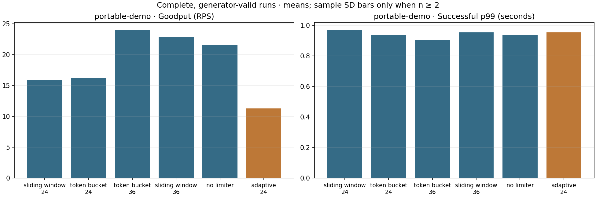
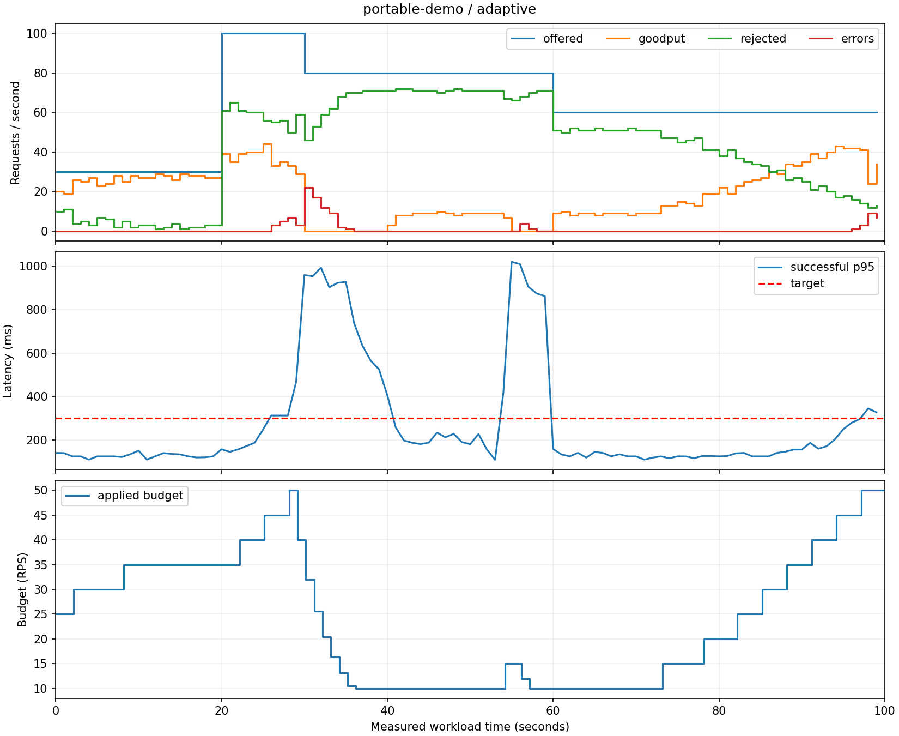

# Verified implementation results

The sections below preserve the original October 24 baseline experiments. The
October 27 PPO/predictive upgrade has a separate [measured report](rl-upgrade/REPORT.md),
including its completion status, trained model provenance, repeated HTTP comparisons,
simulator fidelity, and negative results. Original results have not been replaced.

Verification performed on October 24, 2026, using Python 3.12.9 on Windows 11 and a real Redis 7.4.11 server. The local Redis executable came from the [redis-windows portable build](https://github.com/redis-windows/redis-windows/releases/tag/7.4.11); the delivered Docker deployment uses the official Linux Redis image.

## Checks

- All 43 tests pass. Unit and real-Redis integration tests cover concurrent global/client admission, refill, expiry, budget changes, both denial directions, HTTP forwarding, real network timeouts, cancellation cleanup, controller feedback and failed publication, workload accounting, configuration, reporting, and dashboard provisioning references.
- Ruff lint/format checks and strict mypy checks pass.
- The project builds as a wheel and source distribution.
- Compose configuration parses, and all pinned container image tags were verified against their registries.
- The Docker engine was unavailable, so building/running the complete Docker/Grafana stack and visually checking the live Grafana dashboard remain unverified locally. CI includes a Docker build check.
- Matplotlib emits upstream Pyparsing deprecation warnings under the locked dependencies; tests still pass.

## Portable smoke comparison

The default high-rate demo exceeded this Windows host's generator capacity. Its results were excluded by the report's missed-launch rule. They were not used to claim a policy improvement.

The separately calibrated portable profile used four workers with 100 ms simulated I/O service time and reduced capacity to one worker during degradation. Its short calibration swept 10, 20, 30, 40 and 60 offered RPS, using 1 second warm-up and 4 seconds measurement. The highest passing tested rate was 40 RPS; 60 RPS failed. This is a smoke calibration, not a long-run capacity guarantee.

The six-policy comparison then used a 3-second warm-up and 30-second measurement (`--scale 0.3`), one trial per configuration, and seed 42. **All six trials launched all 1,920 measured arrivals without a missed launch.**



| Policy | Initial budget | Goodput (RPS) | Backend errors | Gateway rejections |
|---|---:|---:|---:|---:|
| Sliding Window | 24 | 15.90 | 112 | 1,239 |
| Token Bucket | 24 | 16.17 | 116 | 1,223 |
| Token Bucket | 36 | 23.97 | 223 | 882 |
| Sliding Window | 36 | 22.87 | 210 | 930 |
| No limiter | Disabled | 21.57 | 1,025 | 0 |
| Adaptive Token Bucket | 24 | 11.27 | 63 | 1,431 |

In this short workload, adaptation reduced backend errors but also rejected more work and achieved lower goodput than either static budget. The smoothed error feedback kept its rate low into recovery. These are single trials with no variability estimate, and do not establish a general ranking. The full evaluation protocol is implemented but has not been executed as a 210-run experiment.

## Full-duration adaptive demonstration

A separate portable adaptive run used the complete 100-second workload plus 10-second warm-up. It launched all **6,400 measured arrivals**, backed off to the 10 RPS floor during degradation, and resumed increasing its rate after capacity returned. Its decision history contains 11 decreases and 15 increases, and ends at 40 RPS after probing up to 50 RPS.



Observed goodput was 18.79 RPS, with 106 backend errors and 4,202 gateway rejections. The stricter report recovery criterion—three consecutive healthy five-second windows at 80% of pre-degradation goodput—was **not met** before the run ended (`recovery_seconds=null`). Resuming budget growth is distinct from proving full service-level recovery. Overshoot and slow EWMA recovery remain visible tuning tradeoffs, not hidden exceptions.

## Reproduce

Start a Redis server, then run from the repository root. These PowerShell commands reproduce the experiment definitions; timings and selected calibration rates can vary by machine:

```powershell
$env:RLRC_CONFIG = 'configs/portable.yaml'
# Set this only when Redis is not at the default localhost:6379:
# $env:RLRC_REDIS_URL = 'redis://127.0.0.1:16379/0'
uv run rlrc calibrate --rates 10 20 30 40 60 --duration 4 --warmup 1 --output results/runs/portable-calibration
uv run rlrc suite --scenarios portable-demo --repetitions 1 --calibration results/runs/portable-calibration/calibration.json --scale 0.3 --output results/runs/portable-verified
uv run rlrc demo --scenario portable-demo --output results/runs/recovery-verified
Remove-Item Env:RLRC_CONFIG
```

Use new output directories when rerunning. To obtain stronger results, use the default 5/15-second calibration and the documented 30/300-second, five-repetition evaluation protocol. Keep controller settings fixed across evaluation workloads.

Selected summaries, manifests, decision history, and source CSV hashes are stored under `verification/`. Large raw request CSVs and per-run reports remain locally in the ignored `results/runs/` directories. No Git commit existed during this initial implementation, so the run manifests truthfully record a null commit; subsequent runs after committing will record that commit.
