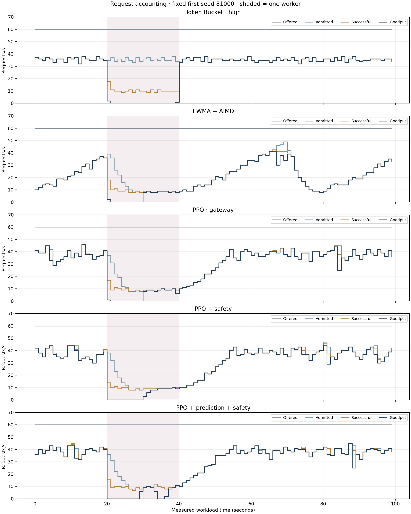
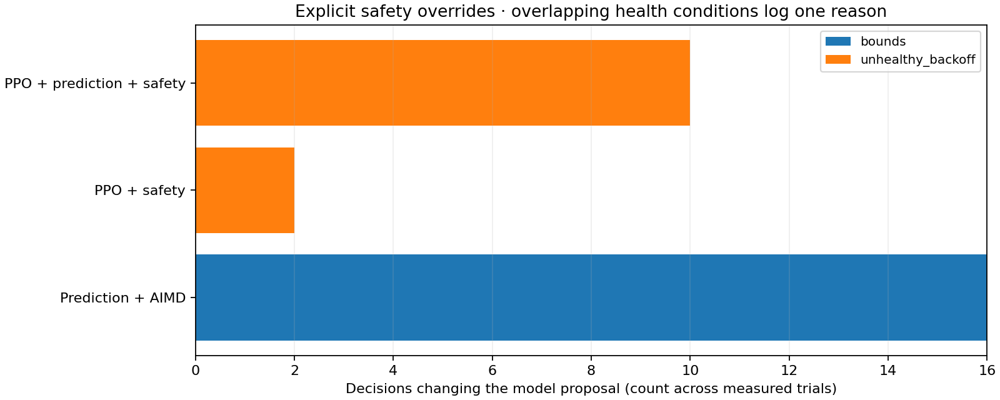
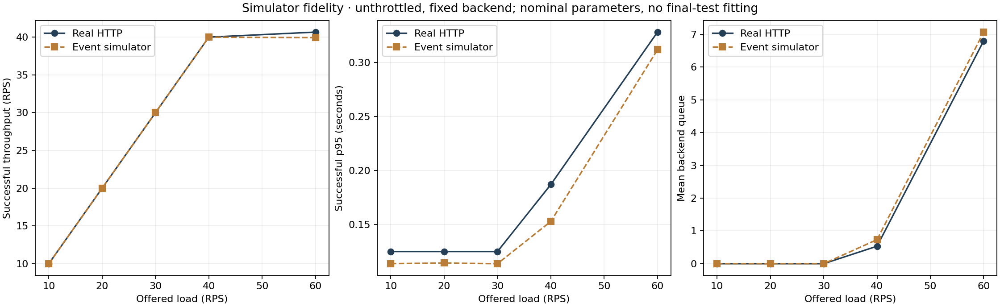
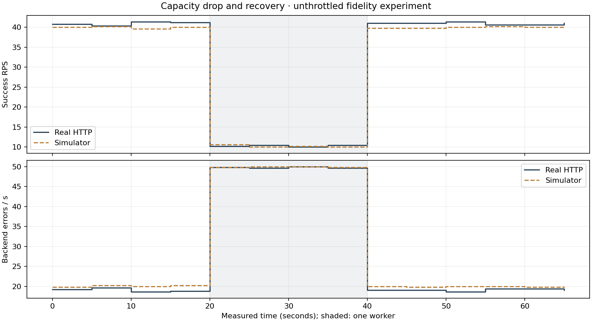
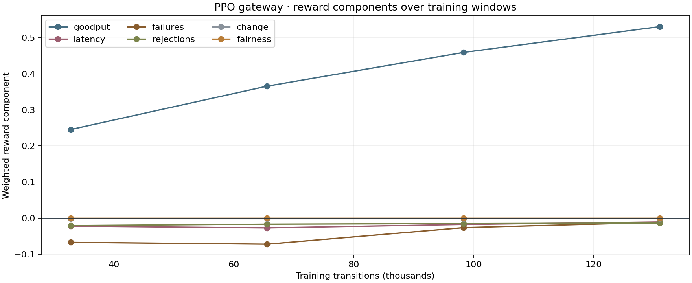
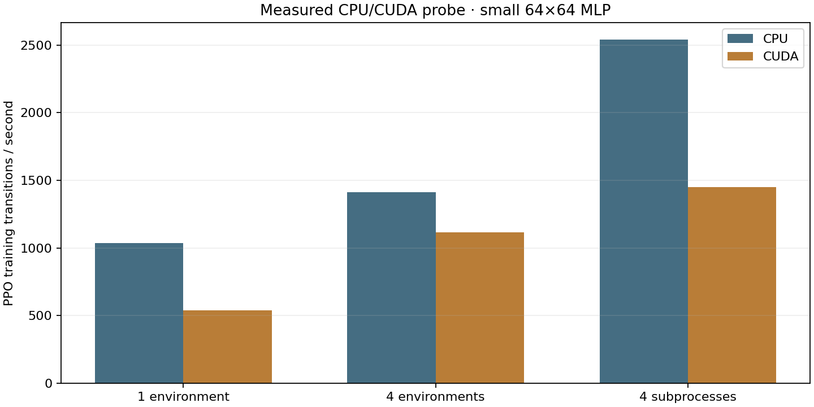
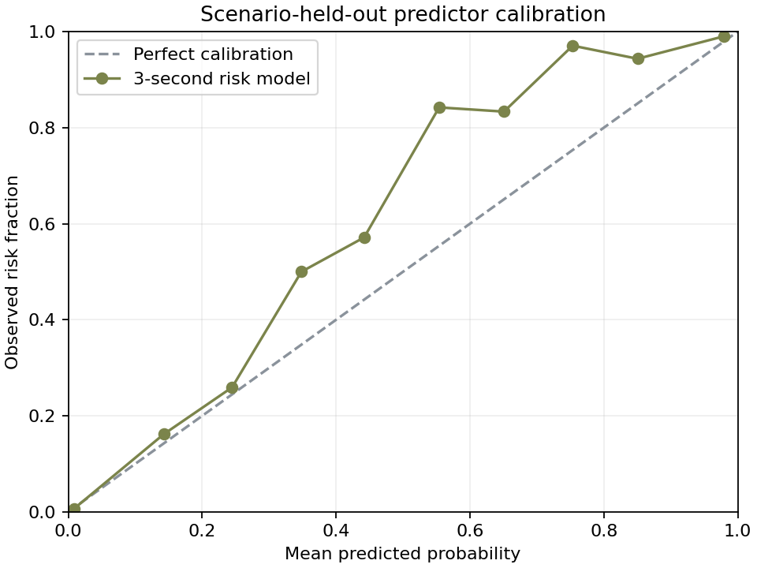

# Reinforcement-learning upgrade: measured results

HTTP evaluation status: **COMPLETE — 33/33 trials finished**, 33 valid.

Simulator results and real HTTP results below are distinct evidence. Models were frozen before final comparisons. These local experiments do not establish production readiness or research novelty.

## Real HTTP/Redis comparison

The highest observed mean goodput is PPO · gateway. This ranking is descriptive; three workload repetitions do not establish a universal best controller.

PPO + safety minus EWMA + AIMD: +10.19 ± 1.34 RPS (paired 95% t interval). The descriptive interval excludes zero. These intervals are not adjusted for multiple comparisons.

PPO + safety minus Token Bucket · high: -0.08 ± 0.49 RPS (paired 95% t interval). The interval includes zero; the goodput difference is inconclusive. These intervals are not adjusted for multiple comparisons.

Read goodput together with backend errors and tail latency. Restoring capacity does not erase queued work during abrupt degradation. The shared minimum budget and more frequent PPO action changes remain limitations. Neither forecast accuracy nor simulator goodput alone proves a deployment benefit.

EWMA + AIMD relative recovery averaged 23.3s among 3/3 recovered trials; mean absolute log budget change was 0.071. The preserved recovery metric references each controller's own pre-degradation throughput. PPO's goodput gain did not also establish a recovery or oscillation improvement.

PPO + safety relative recovery averaged 36.7s among 3/3 recovered trials; mean absolute log budget change was 0.118. The preserved recovery metric references each controller's own pre-degradation throughput. PPO's goodput gain did not also establish a recovery or oscillation improvement.


Three matched workload seeds were scheduled per controller, randomized within each repetition. Each trial has 30 seconds warm-up and 100 seconds measurement: 20 seconds normal, 20 seconds degraded, 60 seconds restored. Offered load is 60 RPS throughout; workers change 4→1→4 with 100ms nominal service and an eight-request backend queue. The same timeout, fairness allocation, target, gateway ceiling, and forwarding path apply to every controller. This is a focused local study, not the full 300-second multi-workload HTTP matrix.

| Controller | Valid n | Goodput RPS (95% t interval) | Successful p99 ms | Backend errors % offered | Rejections % offered |
|---|---:|---:|---:|---:|---:|
| No limiter | 3 | 22.35 ± 3.95 | 912.0 | 42.10 | 0.00 |
| Token Bucket · low | 3 | 18.91 ± 0.13 | 937.4 | 4.42 | 60.67 |
| Token Bucket · high | 3 | 28.44 ± 0.11 | 930.0 | 8.36 | 40.82 |
| Sliding Window · low | 3 | 18.15 ± 0.09 | 932.7 | 4.12 | 62.26 |
| Sliding Window · high | 3 | 26.79 ± 0.36 | 937.3 | 7.63 | 44.29 |
| EWMA + AIMD | 3 | 18.16 ± 1.77 | 906.7 | 1.56 | 65.79 |
| Prediction + AIMD | 3 | 21.60 ± 1.09 | 833.3 | 1.04 | 60.58 |
| PPO · gateway | 3 | 28.75 ± 0.80 | 891.0 | 1.34 | 48.46 |
| PPO + safety | 3 | 28.35 ± 0.47 | 878.0 | 1.09 | 49.37 |
| PPO · backend telemetry | 3 | 28.05 ± 0.97 | 875.0 | 0.80 | 50.70 |
| PPO + prediction + safety | 3 | 28.70 ± 1.76 | 875.0 | 1.29 | 47.97 |

| Controller | Success RPS | p50 ms | p95 ms | Timeouts % offered | Offered / launched (total) | Missed launches % | Model fallback decisions |
|---|---:|---:|---:|---:|---:|---:|---:|
| No limiter | 34.74 | 297.0 | 848.9 | 0.000 | 18000 / 18000 | 0.000 | 0 |
| Token Bucket · low | 20.94 | 110.0 | 885.3 | 0.000 | 18000 / 18000 | 0.000 | 0 |
| Token Bucket · high | 30.49 | 115.0 | 854.0 | 0.000 | 18000 / 18000 | 0.000 | 0 |
| Sliding Window · low | 20.18 | 110.0 | 885.3 | 0.000 | 18000 / 18000 | 0.000 | 0 |
| Sliding Window · high | 28.85 | 125.0 | 864.9 | 0.000 | 18000 / 18000 | 0.000 | 0 |
| EWMA + AIMD | 19.59 | 115.0 | 381.5 | 0.000 | 18000 / 18000 | 0.000 | 0 |
| Prediction + AIMD | 23.03 | 135.3 | 323.1 | 0.000 | 18000 / 18000 | 0.000 | 0 |
| PPO · gateway | 30.12 | 146.0 | 291.7 | 0.000 | 18000 / 18000 | 0.000 | 0 |
| PPO + safety | 29.72 | 141.0 | 292.0 | 0.000 | 18000 / 18000 | 0.000 | 0 |
| PPO · backend telemetry | 29.10 | 130.0 | 254.3 | 0.000 | 18000 / 18000 | 0.000 | 0 |
| PPO + prediction + safety | 30.44 | 151.0 | 323.8 | 0.000 | 18000 / 18000 | 0.000 | 0 |

### Recovery, stability, and overhead

| Controller | Recovery s | Recovered n/total | SLO-violating seconds | Jain fairness | Mean absolute log budget change | Inference p95 ms | Control p95 ms | Gateway RSS p95 MB | Gateway CPU p95 % |
|---|---:|---:|---:|---:|---:|---:|---:|---:|---:|
| No limiter | — | 0/3 | 99.000 | 0.999 | 0.000 | — | — | — | — |
| Token Bucket · low | 15.000 | 3/3 | 20.667 | 1.000 | 0.000 | — | — | — | — |
| Token Bucket · high | 15.000 | 3/3 | 20.000 | 1.000 | 0.000 | — | — | — | — |
| Sliding Window · low | 15.000 | 3/3 | 20.333 | 1.000 | 0.000 | — | — | — | — |
| Sliding Window · high | 15.000 | 3/3 | 20.667 | 1.000 | 0.000 | — | — | — | — |
| EWMA + AIMD | 23.333 | 3/3 | 15.000 | 1.000 | 0.071 | — | 4.291 | 71.901 | 23.560 |
| Prediction + AIMD | 27.500 | 2/3 | 16.667 | 1.000 | 0.074 | 1.513 | 6.867 | 171.284 | 28.215 |
| PPO · gateway | 30.000 | 3/3 | 16.333 | 1.000 | 0.120 | 0.128 | 7.046 | 72.930 | 31.575 |
| PPO + safety | 36.667 | 3/3 | 17.333 | 1.000 | 0.118 | 0.133 | 7.806 | 72.629 | 30.252 |
| PPO · backend telemetry | 26.667 | 3/3 | 11.667 | 1.000 | 0.122 | 0.136 | 15.102 | 72.277 | 30.260 |
| PPO + prediction + safety | 26.667 | 3/3 | 20.333 | 1.000 | 0.115 | 1.593 | 7.997 | 171.435 | 29.848 |

Recovery requires three consecutive 5s windows reaching 80% of that run's pre-degradation goodput with successful p95 within target. It measures stability relative to each controller's own baseline, not equal absolute capacity. Missing recoveries are censored; consult individual summaries. SLO-violating seconds count arrival cohorts with successful p95 above target. CPU/RSS are whole-gateway process samples, not isolated model cost; p95 values are averaged across trials.






Time-series illustrations use the prespecified first seed (81000), not a best-performing repetition. Arrival cohorts count successful completions, including completions after the measurement boundary. All variants' raw traces remain available locally.

Intervals describe run-to-run uncertainty with a small number of seeds; they do not include uncertainty from training seeds or simulator design. Fast rejections are excluded from successful-response latency percentiles. Tail values summarize per-run percentiles (means across repetitions), not a percentile computed from pooling all runs. Any model fallback or excessive missed launches makes a run ineligible for a learned-policy performance claim.

### Paired goodput differences against AIMD

| Controller | Matched seeds | Difference RPS (95% t interval) |
|---|---:|---:|
| No limiter | 3 | +4.19 ± 2.32 |
| Token Bucket · low | 3 | +0.75 ± 1.78 |
| Token Bucket · high | 3 | +10.28 ± 1.82 |
| Sliding Window · low | 3 | -0.01 ± 1.69 |
| Sliding Window · high | 3 | +8.63 ± 1.88 |
| Prediction + AIMD | 3 | +3.44 ± 0.82 |
| PPO · gateway | 3 | +10.59 ± 1.86 |
| PPO + safety | 3 | +10.19 ± 1.34 |
| PPO · backend telemetry | 3 | +9.89 ± 0.80 |
| PPO + prediction + safety | 3 | +10.54 ± 0.15 |

## Held-out simulation


600 episodes: 12 variants, 10 workload families, five matched seeds (40000–40004), each 180 seconds with 30 seconds warm-up. Static budgets use the real calibration's 24/36 RPS. Backend-aware PPO is separately identified. PPO + prediction without safety is a simulator-only ablation; the live hybrid also has safety. The falling-demand and combined unseen profiles were not training families. Inference is deterministic in all policy comparisons.

Highest observed mean by workload (not a significance claim):

| Family | Controller | Goodput RPS |
|---|---|---:|
| steady | No limiter | 32.00 |
| ramp | PPO + prediction | 37.82 |
| falling | PPO + prediction + safety | 30.68 |
| burst | PPO + prediction | 36.26 |
| overload | PPO + prediction | 39.49 |
| sudden | PPO · gateway | 24.86 |
| gradual | PPO · backend telemetry | 27.07 |
| fairness | PPO + prediction | 38.98 |
| aggressive | PPO + prediction | 23.52 |
| unseen | PPO · backend telemetry | 23.91 |

### Stronger conventional comparator (supplemental)

After inspecting initial results, a separate 16-setting conventional search used only the six validation seeds and PPO's independent selection score. It selected a 2s window, EWMA alpha 0.5, one healthy evaluation, +5 RPS steps, and ten observations. The original baseline is unchanged. This is an exploratory supplement, not a retrospectively substituted baseline.

The frozen tuning averaged 26.85 goodput RPS across the same 50 held-out simulator scenarios, versus 21.93 for original AIMD and 31.18 for gateway-only PPO. Faster conventional recovery closes much of the original gap; ML should be compared against such tuning too.

Supplemental HTTP status: 3/3 valid trials. These run after the main randomized study, with matched seeds and identical capacity protocol, so host/time ordering remains a possible confound.

Supplemental tuned-AIMD mean goodput: 25.28 ± 0.93 RPS (95% t interval).

| Tuned AIMD supplemental HTTP | Goodput RPS | Backend errors % offered | Successful p99 ms | Offered / launched | Missed launches % | Admission unknown |
|---|---:|---:|---:|---:|---:|---:|
| Seed 81000 | 25.07 | 2.75 | 891.0 | 6000 / 6000 | 0.000 | 0 |
| Seed 81001 | 25.05 | 2.35 | 867.1 | 6000 / 5972 | 0.467 | 0 |
| Seed 81002 | 25.71 | 2.58 | 890.0 | 6000 / 6000 | 0.000 | 1 |
Supplemental trials retain any missed launches under the same preset ≤1% validity rule. Goodput uses offered measurement duration; missed requests do not earn useful-work credit and are not silently removed or retried.
One supplemental client-side transport failure has unknown admission. It earns no goodput; the recorded trace does not identify its root cause. There were no such failures in the main study.

## Simulator fidelity





The unthrottled HTTP sweep used 5 seconds warm-up and 15 seconds measurement at 10, 20, 30, 40, and 60 RPS. The simulator uses nominal service and 5ms transport overhead without fitting final-test outcomes. Throughput agrees within about 2% on this sweep; simulated p95 is roughly 11–34ms lower. Queue saturation and recovery trends agree qualitatively. This supports coarse dynamics, not exact tail fidelity or transfer to arbitrary real APIs.

## Training and resource choice






Each selected PPO variant trained for 131,072 transitions with four CPU subprocess environments, 256 rollout steps per environment, batch size 256, six epochs, learning rate 0.0003, gamma 0.98, GAE lambda 0.95, and entropy coefficient 0.01. Actor and value networks each use two 64-unit Tanh layers. Checkpoint selection uses six fixed validation scenarios, not held-out tests. Selected deployment actors are exported from those checkpoints; they are not heuristics.
The selected checkpoints are 131,072 transitions for gateway-only PPO, 98,304 for backend-aware PPO, and 32,768 for prediction-aware PPO. Later training did not consistently improve validation performance.

### Environment, observations, actions, and reward

A request-level event heap models arrivals, atomic global/client token budgets, finite workers/queue, overflow, delayed completions, and timeout work that continues on the backend. Traces are generated before policy decisions. Randomized service/capacity/load episodes use Gymnasium time-limit truncation and pass SB3's environment checker. There are no real-time training sleeps.

Six actions multiply the budget by 0.8, 0.9, 0.95, 1, 1.05, or 1.1. Sixteen shared normalized gateway features contain current budget, offered/admitted/completed/goodput RPS, latency EWMA/p90, error/timeout/rejection fractions, in-flight utilization, previous action, demand/latency trends, sample volume and an availability mask. Backend-aware PPO adds queue/busy utilization and a telemetry mask; prediction-aware PPO adds forecast risk. Fixed physical scaling, order, and clipping are identical in training and inference. No future capacity or worker-count oracle enters the gateway-only actor.

For offered O, completed C, timely successes G, late successes L, errors E, timeouts T, relative budget change u, and D=max(1,O,C), the reward is:

```text
G/D - 0.70 L/D - 2.00 (E+T)/D - 0.03 rejected/max(1,O)
    - 0.02 abs(u) - 0.02 (1-Jain)
```

Fairness applies only with equal demands and at least six successes. Useful completions earn reward; admission alone does not. Reject-all loses useful-work reward and pays rejection penalties. Tests cover no demand, useful service, reject-all and overload; this does not prove absence of reward hacking. Reported HTTP goodput uses end-user latency; the live feature uses upstream timing as an available estimate.

The 2,048-transition hardware probe used 128 rollout steps and three epochs. Four CPU subprocesses measured about 2,539 transitions/s versus 1,450 with CUDA. CUDA was available on the RTX 4070 SUPER, but CPU was faster for this MLP probe. These are single throughput probes, not statistically repeated speed claims. Live actors run with NumPy, verified against PPO actions, without loading PyTorch or running inference on individual requests.

## Optional predictor



Scenario-held-out ROC AUC: 0.9899; average precision: 0.9601; Brier: 0.0184, versus 0.1065 for constant prevalence and 0.0283 for current-health persistence (p90 above target or error fraction above 2%). Persistence is a stronger comparator than constant prevalence.

A calibrated histogram gradient-boosted classifier predicts whether any of the next three seconds violates latency/error thresholds under the sampled behavior policy. Fitting, calibration, and testing use whole disjoint scenario seed groups. Held-out AUC/Brier alone do not prove proactive prediction of unannounced capacity failures, or a causal outcome for a proposed budget. Simulator ablations show little additional goodput from prediction or backend instrumentation over the simpler gateway-only PPO. They remain optional.

## Engineering, limitations, and reproduction

A post-training simulator edge audit found raw PPO raises its budget to 120 RPS even with no demand, without earning useful work. Safety holds the initial budget when there are no samples. With only 5 RPS demand, both PPO variants can raise the unused budget to the ceiling: sparse but steady successful samples satisfy the current guard. This can increase exposure to a later burst and is an unresolved demand-awareness weakness. When capacity is just 2 RPS, every controller's 10 RPS floor is too high and timely goodput falls to zero. No claim of universal safe operation is made.

See [RL implementation and commands](../../docs/rl.md). The original Redis algorithms and EWMA/AIMD policy remain available. The safety layer guards bounds, jumps, timeouts, unhealthy increases, and sparse samples; explicit inference/load failures fall back to AIMD and are logged. Model files and normalization are validated at startup.

Limitations include one trained seed per selected architecture, a single controlled backend and host, simplified uniform/lognormal service distributions, fixed equal client quotas, a minimum budget that can itself exceed very small backend capacity, simulation timing approximation, and limited real workload coverage. Three workload repetitions do not establish generalization across hardware or retraining variability. Docker configuration and packaging can be checked locally, but a complete local Docker/Grafana run is unavailable while the Docker engine is stopped. CI's previous Linux typing issue was identified and repaired; a new remote CI run has not been claimed.

Full request CSVs, training logs, checkpoints, simulator episode records and source/model snapshots are retained under ignored `results/ml-runs/` and `models/`. Reviewed summaries and model provenance accompany this report. The owner's extended guide remains local and Git-ignored.
